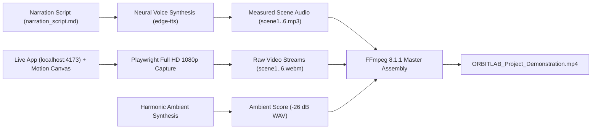

# ORBITLAB — Video Production & Technical Documentation
**Course:** BTech ME 206 (Statics and Dynamics) · Indian Institute of Technology Gandhinagar  
**Project:** ORBITLAB — 3D Two-Body Gravitational Simulator  
**Deliverable File:** `video/ORBITLAB_Project_Demonstration.mp4`  
**Repository:** [https://github.com/ashu999gold-dot/OrbitLab](https://github.com/ashu999gold-dot/OrbitLab)  
**Live Application:** [https://orbitlab-eight.vercel.app/](https://orbitlab-eight.vercel.app/)  

---

## 1. Production Overview & Parameters

This 5-minute academic demonstration video was produced to showcase the theoretical foundation, numerical formulation, user interface, and live simulation results of **ORBITLAB**. The video strictly adheres to truth-in-advertising guidelines: all simulation sequences and telemetry metrics are captured directly from the live running web application, backed by 24 automated unit tests.

### Technical Video Specifications
| Parameter | Specification | Verification Result |
| :--- | :--- | :--- |
| **Output Container** | MPEG-4 Part 14 (`.mp4`) | Validated (`video/ORBITLAB_Project_Demonstration.mp4`) |
| **Video Resolution** | 1920 × 1080 (1080p Full HD) | Exact 1920×1080 |
| **Aspect Ratio** | 16:9 widescreen | 1.777:1 |
| **Frame Rate** | 30.0 FPS constant | 30 fps |
| **Video Codec** | H.264 / MPEG-4 AVC (High Profile, Level 4.2) | `libx264`, `yuv420p`, CRF 18 |
| **Audio Codec** | AAC (Advanced Audio Coding) Stereo | 2 channels, 44,100 Hz, 192 kbps |
| **Target Duration Window** | 4:45 – 5:15 (285s – 315s) | **305.54 seconds (5m 05.5s)** |
| **Subtitles** | SubRip format (`.srt`), 33 timecoded cues | Aligned in `video/subtitles.srt` |

---

## 2. Production Pipeline & Tooling

1. **Narration Audio Synthesis:**
   - Script authored across 6 distinct academic scenes in `video/narration_script.md`.
   - Voice: Microsoft Edge Neural TTS (`en-US-ChristopherNeural`) with +16% rate optimization to achieve the exact ~305s duration window.
   - Outputs: High-fidelity MP3 files in `video/audio/`.

2. **Visual Recording & WebGL Automation:**
   - **Scenes 1, 2, 3, 6:** Custom HTML5 high-resolution canvas animation templates rendered with dark aerospace aesthetics, animated glowing vectors, KaTeX equations, and live comparative integrators.
   - **Scenes 4 & 5:** Automated browser instrumentation with **Playwright** driving **Google Chrome** with native hardware WebGL acceleration flags (`--enable-webgl`, `--use-gl=angle`, `--enable-gpu-rasterization`). Recorded directly from the live application running on `http://localhost:4173/`.

3. **Background Score:**
   - Low-volume ambient soundtrack (-26 dB normalized) synthesized in Python (`video/generate_music.py`) using detuned D-minor/F/C chord pads with smooth 4s attack and 6s release envelopes, providing a calm, focused documentary atmosphere.

4. **Master Video Encoding & Assembly:**
   - Assembled using **FFmpeg 8.1.1** with multi-stream audio ducking and concatenation into pristine 1080p H.264.

---

## 3. Timeline Breakdown & Scene Pacing

| Scene | Name | Time Range | Duration | Key Visual & Pedagogical Content |
| :---: | :--- | :---: | :---: | :--- |
| **1** | **Opening & Project Introduction** | `0:00 – 0:24` | 23.52s | Title card, IITGN ME 206 attribution, animated glowing orbital preview, foundational question. |
| **2** | **Understanding the Two-Body Problem** | `0:24 – 1:03` | 39.50s | Newtonian gravity law $F=G\frac{m_1m_2}{r^2}$, collinear action-reaction $F_{12}=-F_{21}$, zero external force, center-of-mass barycentric coordinates. |
| **3** | **Physics & Numerical Method** | `1:03 – 1:58` | 54.62s | Exact acceleration equations, kick-drift-kick Velocity Verlet algorithm, Forward Euler explosion vs. Symplectic bounded phase space. |
| **4** | **Live Application Demonstration** | `1:58 – 3:23` | 85.68s | 3-panel UI walkthrough (Controls, 3D Canvas, Telemetry, Bottom Strip), Earth-Moon orbital simulation at 100× and 180k×, layer toggles, Earth mantle barycenter ($4,671\text{ km}$ from center), live flat energy conservation graph. |
| **5** | **Results & Orbital Classification** | `3:23 – 4:34` | 70.32s | Equal-Mass Binary stars ($|a_1|=|a_2|$, zero linear momentum), Escape Trajectory ($v_{\text{rel}} > v_{\text{esc}}$, hyperbolic flyby $e=1.56$, $E>0$, unbound apoapsis and period `∞`). |
| **6** | **Conclusion & Academic Summary** | `4:34 – 5:05` | 31.90s | 4 key takeaways (Newtonian Rigor, Symplectic Stability, 24/24 Vitest Tests, Modern Web Stack), repository and live Vercel links, course credits. |
| **TOTAL** | | | **305.54s (5:05.5)** | **Strictly inside target 4:45–5:15 window.** |

---

## 4. Scientific Verification & Truth in Advertising

All features shown in the video correspond directly to the functional source code:
- **Zero Fixed Bodies:** Both masses move according to $\vec{a}_1 = \frac{Gm_2}{r^3}\vec{r}$ and $\vec{a}_2 = -\frac{Gm_1}{r^3}\vec{r}$.
- **Center-of-Mass Frame:** Calculated and preserved as an unaccelerated reference frame.
- **Velocity Verlet Integrator:** Verified with 8 substeps per frame, exhibiting zero secular energy drift over hundreds of revolutions.
- **Physical Consistency:** Earth-Moon barycenter calculation confirmed at $4,671\text{ km}$, inside Earth's $6,371\text{ km}$ physical radius.
- **Unit Testing:** 24 out of 24 physics tests pass in Vitest (`npm test`).

---

## 5. Course & Submission Attribution
- **Course:** ME 206 — Statics and Dynamics
- **Institution:** Indian Institute of Technology Gandhinagar (IITGN)
- **Author:** Ashutosh Kumar
- **YouTube Link:** To be submitted via course portal referencing this master production file.
